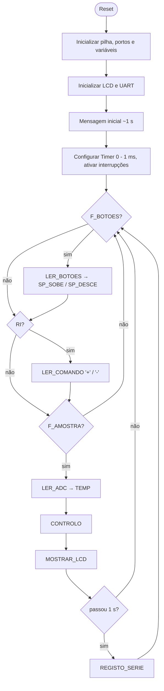
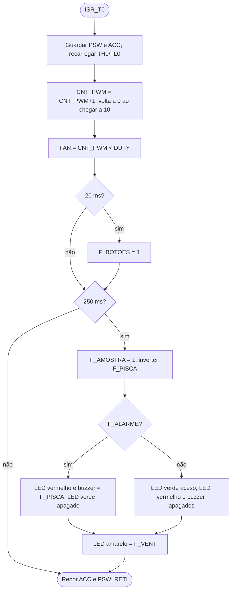

# Relatório — Mini Projeto MCS‑51

## Termóstato digital com ventoinha controlada por PWM

**Unidade curricular:** Microprocessadores / Microcontroladores
**Plataforma:** AT89C51 (MCS‑51), programação em Assembly, simulação em PROTEUS
**Autor:** _(nome / número)_
**Data:** _(data)_

---

## 1. Introdução

O objetivo deste trabalho é projetar, programar em Assembly e simular em PROTEUS uma montagem controlada por um microcontrolador da família MCS‑51. A aplicação escolhida é um **termóstato digital**: o sistema mede a temperatura ambiente, compara‑a com um valor de referência (*setpoint*) escolhido pelo utilizador e atua sobre uma ventoinha para arrefecer. A velocidade da ventoinha depende do afastamento entre a temperatura medida e o setpoint.

A aplicação junta vários interfaces estudados nas aulas:

- **entrada analógica** (sensor LM35 e conversor analógico‑digital ADC0804);
- **saída alfanumérica** (LCD 16x2 com controlador HD44780);
- **entradas digitais** (botões, com antirressalto por software);
- **atuação de potência** (motor DC através do *driver* L293D, comandado por PWM);
- **sinalização** (LEDs e buzzer);
- **comunicação série assíncrona** (UART a 9600 bps para registo de dados e comandos remotos);
- **temporizadores e interrupções** (Timer 0 como base de tempo de 1 ms, Timer 1 como gerador de *baud rate*).

## 2. Especificação funcional

| Requisito | Solução |
|---|---|
| Medir a temperatura de 0 a 150 °C com resolução de 1 °C | LM35 + ADC0804 com VREF/2 = 1,28 V |
| Mostrar temperatura, setpoint, velocidade da ventoinha e estado | LCD 16x2, atualizado a cada 250 ms |
| Ajustar o setpoint entre 15 °C e 60 °C | Botões SUBIR/DESCER e comandos `+`/`-` pela série |
| Ligar a ventoinha acima do setpoint, com histerese | Controlo ON/OFF com banda de 1 °C |
| Velocidade proporcional ao erro | PWM de 10 níveis (100 Hz): 30 % + 10 %/°C, máx. 100 % |
| Alarme de sobretemperatura | T ≥ SP + 10 °C → LED vermelho e buzzer a 2 Hz |
| Registo de dados | Uma linha de estado por segundo na porta série |

## 3. Fundamentos teóricos

### 3.1 Microcontrolador MCS‑51 (AT89C51)

O 8051 é um microcontrolador de 8 bits com arquitetura de Harvard: memória de programa (4 KB de Flash no AT89C51) separada da memória de dados (128 bytes de RAM interna). Inclui 4 portos de E/S de 8 bits (P0–P3), 2 temporizadores/contadores de 16 bits, uma UART *full‑duplex* e 5 fontes de interrupção com 2 níveis de prioridade.

Aspetos relevantes para o projeto:

- **Ciclo máquina** = 12 períodos de relógio. Com um cristal de 11,0592 MHz: T<sub>CM</sub> = 12 / 11,0592 MHz ≈ 1,085 µs.
- **Portos:** P1, P2 e P3 têm *pull‑ups* internas (portos quase‑bidirecionais); para usar um pino como entrada escreve‑se 1 no *latch*. O **P0 é de dreno aberto** e precisa de resistências de *pull‑up* externas (RESPACK‑8) quando usado como saída de nível alto.
- **Área endereçável ao bit** (20h–2Fh): usada para as *flags* do programa, manipuladas com `SETB`, `CLR`, `JB`, `JNB`.
- **Pilha:** cresce para endereços superiores; foi colocada a partir de 60h para não sobrepor as variáveis (30h–37h).

Mapa de memória usado:

| Endereço | Uso |
|---|---|
| 00h–07h | Banco de registos 0 (R0–R7) |
| 20h (bits 00h–05h) | Flags: F_AMOSTRA, F_BOTOES, F_VENT, F_ALARME, F_PISCA, F_SERIE |
| 30h–37h | Variáveis: SETPT, TEMP, DUTY, CNT_PWM, CNT_20MS, CNT_250MS, BTN_ANT, CNT_LOG |
| 60h–7Fh | Pilha |

### 3.2 Sensor LM35

O LM35 é um sensor de temperatura integrado com saída de tensão linear, calibrada diretamente em graus Celsius:

V<sub>OUT</sub> = 10 mV/°C × T

A 25 °C a saída é 250 mV; a 150 °C é 1,5 V. Não precisa de calibração externa.

### 3.3 Conversor ADC0804

O ADC0804 é um conversor de aproximações sucessivas de 8 bits, com saídas *tri‑state* compatíveis com barramentos de microprocessador. O resultado é

N = V<sub>IN</sub> / V<sub>REF</sub> × 256, com V<sub>REF</sub> = 2 × (VREF/2).

Escolhendo **VREF/2 = 1,28 V**, a gama de entrada fica 0–2,56 V e a resolução é

2,56 V / 256 = **10 mV por LSB = 1 °C por LSB**.

Desta forma, **o valor lido do ADC é diretamente a temperatura em °C**, sem qualquer cálculo — uma escolha de projeto que simplifica muito o software em Assembly (o 8051 não tem instruções de vírgula flutuante).

Relógio interno com rede RC: f<sub>CLK</sub> ≈ 1 / (1,1·R·C) = 1 / (1,1 × 10 kΩ × 150 pF) ≈ 606 kHz, o que dá um tempo de conversão de cerca de 66–73 períodos de relógio ≈ 110–120 µs.

Protocolo de leitura (com /CS sempre a 0):

1. impulso a 0 em **/WR** → inicia a conversão (e repõe /INTR a 1);
2. esperar que **/INTR** vá a 0 → conversão terminada;
3. **/RD** a 0 → o ADC coloca o resultado no barramento; ler P1; **/RD** a 1.

O programa implementa uma espera com *timeout* (~1 ms): se o ADC não responder, mantém a última temperatura válida em vez de bloquear.

### 3.4 LCD alfanumérico HD44780 (LM016L)

O LCD é comandado em **modo de 8 bits**: os dados vão para P2, **RS** escolhe entre comando (0) e caractere (1) e um impulso em **E** valida a escrita. O pino R/W está ligado a GND (só escrita), pelo que, em vez de ler a *busy flag*, o programa espera um tempo fixo após cada escrita: ~50 µs para comandos normais e caracteres, ~2 ms para *Clear Display* e *Return Home*.

Sequência de inicialização: espera de 20 ms, `38h` (8 bits, 2 linhas, 5×7) três vezes, `0Ch` (display ligado, cursor desligado), `06h` (incremento automático), `01h` (limpar). Os comandos `80h` e `C0h` posicionam o cursor no início da linha 1 e da linha 2. O caractere `0DFh` da ROM do HD44780 é o símbolo de grau (°).

### 3.5 Modulação por largura de impulso (PWM) e L293D

A velocidade média de um motor DC é proporcional à tensão média aplicada. Com PWM, aplica‑se a tensão total durante uma fração **D** (*duty cycle*) de cada período, obtendo‑se V<sub>médio</sub> = D × V<sub>S</sub>.

O PWM é gerado por software na interrupção do Timer 0 (a cada 1 ms): um contador percorre 0…9 e o pino do motor fica a 1 enquanto contador < DUTY. Resulta um sinal de **10 ms de período (100 Hz)** e 10 níveis de *duty cycle* (0 %, 10 %, …, 100 %).

O microcontrolador não fornece corrente suficiente para um motor; o **L293D** (ponte H dupla) faz essa interface: com EN1 = 1 e IN2 = 0, a saída OUT1 segue IN1 (P3.7) e alimenta o motor a partir de VS. Inclui díodos de roda livre internos.

### 3.6 Temporizadores e interrupções

- **Timer 0, modo 1 (16 bits):** recarregado com
  65536 − (11 059 200 / 12) / 1000 ≈ 65536 − 922 = **FC66h** → interrupção a cada 1 ms.
  A rotina de interrupção gera o PWM, as bases de tempo de 20 ms (leitura de botões) e 250 ms (amostragem, LCD e intermitência a 2 Hz).
- **Timer 1, modo 2 (8 bits com recarga automática):** gerador de *baud rate* da UART:
  TH1 = 256 − 11 059 200 / (384 × 9600) = 256 − 3 = **FDh** → 9600 bps exatos.

É por isto que se usa um cristal de 11,0592 MHz: é múltiplo exato das velocidades série normalizadas.

A rotina de interrupção guarda apenas `PSW` e `ACC` na pilha porque não usa os registos R0–R7; assim o programa principal nunca vê o seu contexto alterado.

### 3.7 Comunicação série (UART)

A UART funciona em **modo 1** (8 bits, 1 *start*, 1 *stop*, *baud rate* variável), configurada com `SCON = 50h` (REN = 1). A transmissão é feita por *polling* da flag **TI**; a receção é verificada no ciclo principal através da flag **RI**. No PROTEUS liga‑se um *Virtual Terminal*.

### 3.8 Antirressalto dos botões

Os contactos mecânicos geram vários impulsos ao serem premidos (*bounce*, tipicamente < 10 ms). Os botões são lidos apenas a cada **20 ms**; como esse intervalo é maior que a duração do *bounce*, cada pressão é vista como uma única transição. A deteção é feita **por flanco** (botão premido agora e não premido na leitura anterior):

`novos = (estado_atual XOR estado_anterior) AND estado_atual`

## 4. Hardware

### 4.1 Diagrama de blocos

```
          ┌───────┐   VIN+   ┌─────────┐  DB0-7  ┌──────────────┐  D0-7   ┌───────────┐
          │ LM35  ├─────────►│ ADC0804 ├────────►│ P1        P2 ├────────►│ LCD 16x2  │
          └───────┘          │         │◄─/RD────┤ P0.4         │  RS,E   │ (LM016L)  │
       VREF/2=1,28V ────────►│         │◄─/WR────┤ P0.5    P3.5 ├────────►│           │
                             │         ├─/INTR──►│ P3.2    P3.6 │         └───────────┘
                             └─────────┘         │              │
 BTN SUBIR ─────────────────────────────────────►│ P3.3         │  IN1   ┌───────┐   ┌───────┐
 BTN DESCER ────────────────────────────────────►│ P3.4    P3.7 ├───────►│ L293D ├──►│ MOTOR │
                                                 │   AT89C51    │        └───────┘   └───────┘
 Virtual Terminal  TXD ─────────────────────────►│ P3.0 (RXD)   │
                   RXD ◄─────────────────────────┤ P3.1 (TXD)   │
                                                 │ P0.0..P0.3   ├──► LED verde, LED vermelho,
                                                 └──────────────┘    buzzer, LED amarelo
```

### 4.2 Atribuição de pinos

| Pino | Direção | Função |
|---|---|---|
| P1.0–P1.7 | entrada | Dados do ADC0804 |
| P2.0–P2.7 | saída | Dados do LCD |
| P3.0 / P3.1 | E / S | RXD / TXD (porta série) |
| P3.2 | entrada | /INTR do ADC0804 |
| P3.3 / P3.4 | entrada | Botões SUBIR / DESCER (ativos a 0) |
| P3.5 / P3.6 | saída | RS / E do LCD |
| P3.7 | saída | PWM da ventoinha (IN1 do L293D) |
| P0.0 | saída | LED verde — sistema OK (ativo a 0) |
| P0.1 | saída | LED vermelho — alarme (ativo a 0) |
| P0.2 | saída | Buzzer (ativo a 0) |
| P0.3 | saída | LED amarelo — ventoinha ligada (ativo a 0) |
| P0.4 / P0.5 | saída | /RD e /WR do ADC0804 |

Os LEDs são ligados em lógica negativa (cátodo no pino, ânodo a +5 V por 330 Ω): o 8051 consegue absorver muito mais corrente (I<sub>OL</sub>) do que fornecer com as *pull‑ups* fracas. Corrente em cada LED: (5 V − 2 V) / 330 Ω ≈ 9 mA.

A lista completa de componentes e ligações para o PROTEUS está em `montagem-proteus.md`.

## 5. Software

### 5.1 Organização

O programa (`src/termostato.asm`, cerca de 860 bytes de código) divide‑se em:

| Rotina | Função |
|---|---|
| `INICIO` | Configura portos, variáveis, LCD, UART, mensagem inicial e Timer 0 |
| `CICLO` | Ciclo principal (*super‑loop*) orientado por flags |
| `ISR_T0` | Interrupção de 1 ms: PWM, bases de tempo, intermitência, LEDs |
| `LER_ADC` | Protocolo de conversão/leitura do ADC0804 com *timeout* |
| `CONTROLO` | Lógica do termóstato: histerese, duty cycle, alarme |
| `LER_BOTOES` | Leitura com deteção de flanco (antirressalto por amostragem) |
| `SP_SOBE`, `SP_DESCE` | Alteração do setpoint com limites |
| `LER_COMANDO` | Interpretação dos comandos `+`/`-` recebidos pela UART |
| `MOSTRAR_LCD`, `REGISTO_SERIE` | Formatação da informação no LCD e na série |
| `PUTC`, `PUT_STR`, `PUT_DEC3`, `PUT_DEC2` | Saída de texto com destino selecionável (LCD ou UART) |
| `LCD_INIT`, `LCD_CMD`, `LCD_DADO` | Controlador do LCD |
| `SERIE_INIT`, `SERIE_TX` | Controlador da UART |
| `ATRASO_50US`, `ATRASO_MS` | Atrasos por software |

Uma decisão de projeto importante é a **rotina `PUTC` com destino selecionável** pela flag `F_SERIE`: as mesmas rotinas de formatação numérica (`PUT_DEC3`, `PUT_DEC2`, `PUT_STR`) servem para o LCD e para a porta série, evitando código duplicado.

### 5.2 Fluxograma do programa principal



### 5.3 Fluxograma da interrupção do Timer 0 (1 ms)



### 5.4 Algoritmo de controlo

Com ΔT = T − SP:

```
se ΔT < 0             → ventoinha desligada, DUTY = 0
se ΔT = 0             → mantém o estado anterior (histerese)
se ΔT > 0 (ou ΔT = 0 e já estava ligada):
        DUTY = min(3 + ΔT, 10)        (30 % … 100 %)
se ΔT ≥ 10            → ALARME
```

A banda de histerese evita que a ventoinha esteja constantemente a ligar e desligar quando a temperatura oscila 1 °C em torno do setpoint. O *duty cycle* mínimo de 30 % garante binário de arranque suficiente para o motor.

A comparação é feita com `SUBB` (subtração com *borrow*): depois de `CLR C` e `SUBB A,SETPT`, a flag **C = 1** indica T < SP. A mesma técnica é usada no PWM (`SUBB A,DUTY` deixa C = 1 enquanto o contador é menor que o *duty*) e a flag C é copiada diretamente para o pino do motor com `MOV FAN,C` — uma instrução de manipulação de bits típica do 8051.

### 5.5 Conversão binário → decimal

Para mostrar valores no LCD é necessário converter um byte em dígitos ASCII. A instrução `DIV AB` divide A por B, deixando o quociente em A e o resto em B:

```
A / 100 → centenas,  resto / 10 → dezenas e unidades
dígito ASCII = dígito + '0' (30h)
```

Os zeros à esquerda são substituídos por espaços para manter o alinhamento (por exemplo, ` 25` e `100`).

## 6. Resultados e testes

### 6.1 Simulação em PROTEUS

| Ensaio | Condição (LM35 / SP) | LCD | Ventoinha | LEDs / buzzer |
|---|---|---|---|---|
| 1 | 25 °C / 28 °C | `T= 25°C SP=28°C` / `VENT:  0%   OK` | parada | verde |
| 2 | 33 °C / 28 °C | `VENT: 80%   OK` | 80 % | verde + amarelo |
| 3 | 40 °C / 28 °C | `VENT:100% ALARME` | 100 % | vermelho e buzzer a piscar, amarelo |
| 4 | 29 °C / 29 °C (vindo de cima) | `VENT: 30%   OK` | 30 % (histerese) | verde + amarelo |
| 5 | 28 °C / 29 °C | `VENT:  0%   OK` | parada | verde |
| 6 | botões SUBIR/DESCER | SP muda de imediato | — | — |
| 7 | `+`/`-` no Virtual Terminal | SP muda de imediato | — | — |

_(Inserir aqui as capturas de ecrã do PROTEUS para cada ensaio, incluindo o osciloscópio no pino P3.7 a mostrar o PWM de 100 Hz com 30 % e 80 % de duty cycle.)_

### 6.2 Verificação automática do firmware

Além do PROTEUS, o código foi verificado no simulador de linha de comando **ucsim (s51)** com o script `test/simular.sh`: o valor do ADC é imposto em P1, /INTR é forçado a 0 e os botões são simulados forçando P3.3/P3.4 a 0. A saída da porta série é comparada com o resultado esperado:

```
Termostato MCS-51 - comandos: + sobe SP, - desce SP
T= 25C SP=28C VENT:  0%   OK
T= 33C SP=28C VENT: 80%   OK
T= 40C SP=28C VENT:100% ALARME
T= 40C SP=29C VENT:100% ALARME
T= 29C SP=29C VENT: 30%   OK
T= 28C SP=29C VENT:  0%   OK
T= 28C SP=28C VENT:  0%   OK
T= 26C SP=28C VENT:  0%   OK
```

Esta sequência confirma a leitura do ADC, o cálculo do *duty cycle*, a histerese (linha com T = SP = 29 °C mantém a ventoinha a 30 %), o limiar do alarme (ΔT = 11 e ΔT = 12), o botão SUBIR (28 → 29) e o botão DESCER (29 → 28).

## 7. Dificuldades e melhorias possíveis

- **Tempo de execução das rotinas do LCD:** como R/W está a GND, os atrasos são fixos; ler a *busy flag* tornaria a escrita mais rápida.
- **Resolução:** com 8 bits e 10 mV/LSB, a resolução é 1 °C. Um ADC de 10/12 bits ou VREF menor permitiria décimas de grau (à custa da gama).
- **Filtragem:** pode fazer‑se a média de 4 ou 8 leituras para reduzir ruído real do sensor.
- **Memória do setpoint:** guardar o SP numa EEPROM I²C (ex.: 24C02) para não se perder ao desligar.
- **Aquecimento:** acrescentar um relé para uma resistência de aquecimento e transformar o sistema num controlador de dois sentidos.
- **Controlo PI** em vez de proporcional, para eliminar o erro em regime permanente.

## 8. Conclusão

Foi desenvolvido um termóstato digital completo baseado no AT89C51, programado inteiramente em Assembly MCS‑51 e validado em simulação. O projeto aplica de forma integrada os principais recursos do microcontrolador — portos de E/S, manipulação de bits, temporizadores, interrupções e UART — e a interface com periféricos analógicos e digitais (sensor, ADC, LCD, *driver* de motor). Escolhas de hardware como VREF/2 = 1,28 V e o cristal de 11,0592 MHz mostraram como o projeto do circuito pode simplificar significativamente o software em Assembly.

## Referências

- Intel, *MCS‑51 Microcontroller Family User's Manual*.
- Atmel, *AT89C51 Datasheet*.
- Texas Instruments, *LM35 Precision Centigrade Temperature Sensors* (datasheet).
- Texas Instruments, *ADC0801/ADC0802/ADC0803/ADC0804/ADC0805 8‑Bit µP Compatible A/D Converters* (datasheet).
- Hitachi, *HD44780U (LCD‑II) Dot Matrix Liquid Crystal Display Controller/Driver* (datasheet).
- Texas Instruments, *L293x Quadruple Half‑H Drivers* (datasheet).
- M. A. Mazidi, J. G. Mazidi, R. D. McKinlay, *The 8051 Microcontroller and Embedded Systems*, Pearson.
- EdSim51 — simulador 8051 (edsim51.com).
